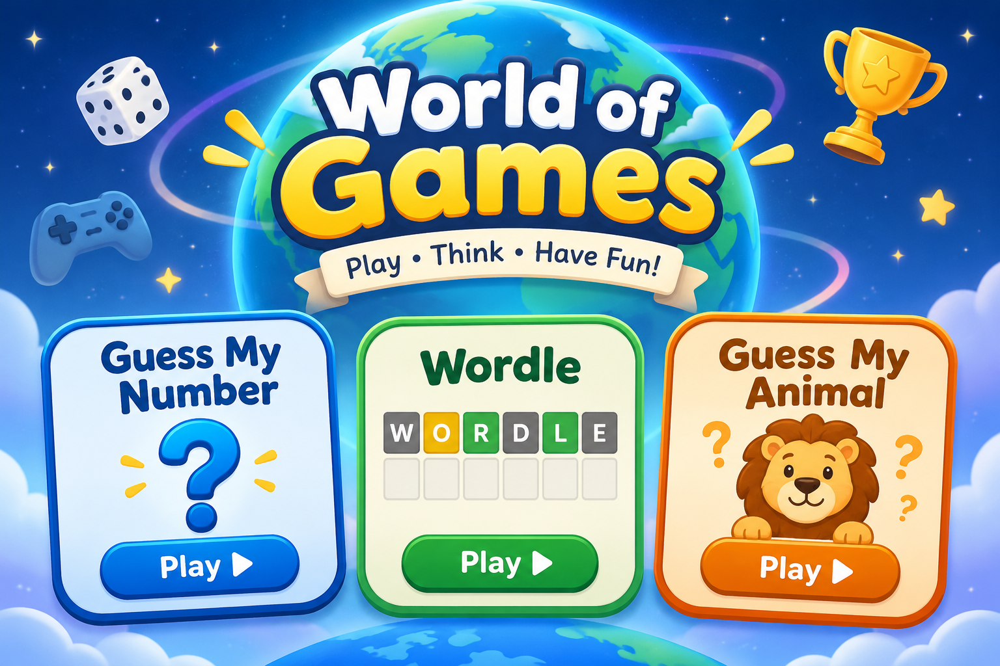

# 🎮 World of Games

**My First Python Coding Project | Code in Place X**

Welcome to World of Games!

This is my first coding project using Python, bringing together various coding techniques and tools I learned from Code in Place X to develop a collection of simple yet fun games.

I've also added my own twists and challenges to the original concepts, not only to test and strengthen my coding skills but also to make the games more engaging, challenging, and enjoyable to play.

## 🕹️ Games Included

### 1. Guess My Number 🔢

Try to guess a randomly generated number between 1 and 100 within six attempts. Receive hints along the way to help you find the correct answer.

### 2. Wordle 🟩

Guess a randomly selected five-letter word within six attempts. Get feedback on whether each letter is in the correct position, appears elsewhere in the word, or does not appear at all.

### 3. Guess My Animal 🐘

Play a Twenty Questions-style guessing game! Ask yes-or-no questions to figure out which animal has been randomly selected. Choose between Easy and Normal modes, with Easy mode providing additional clues.

## 🛠️ Technologies & Concepts

- Python
- Functions and modules
- Loops and conditional statements
- Lists and dictionaries
- Random number and selection techniques
- String manipulation
- User input and validation
- AI integration

## 🚀 Try It Out

[Play World of Games on Code in Place](https://codeinplace.stanford.edu/cipx/share/Y19nNmf4nW1dC5bwXsel)

## 📚 Learning Journey

This project represents my first step into programming with Python through Code in Place X. It has been a great opportunity to put what I've learned into practice, experiment with different coding techniques, and challenge myself to build something of my own.
